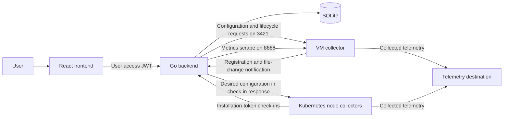
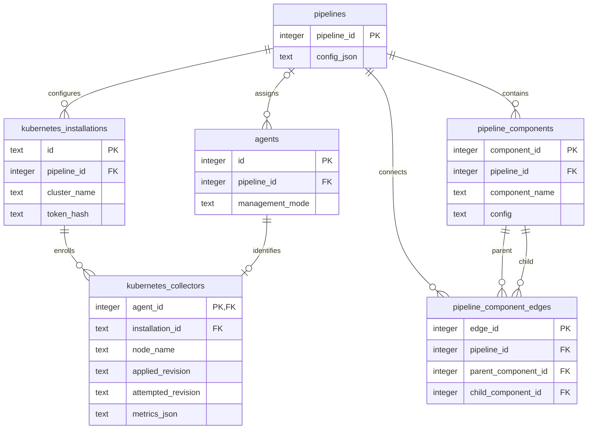

# Architecture

CtrlB Control Plane has a React frontend, a Go API backed by SQLite, and a Go wrapper around the OpenTelemetry Collector. VM collectors and Kubernetes collectors share the pipeline graph model but use different management protocols.

A pipeline defines telemetry collection, processing, and export. A Kubernetes installation assigns one shared pipeline to its per-node collectors. A telemetry destination receives exported telemetry and is configured separately from the control-plane API.

The Kubernetes response arrow represents the response to an outbound collector request. The backend does not initiate a connection to Kubernetes collector pods.

## Components

### Frontend

The UI uses React, TypeScript, Vite, and React Flow. It provides user registration/login, a graph editor with schema-based component forms, VM collector management, and Kubernetes installation setup and status.

The backend supplies component configuration schemas and UI schemas. The editor connects receivers, processors, and exporters, then sends the graph to the backend for compilation. Pipeline details include configuration previews and health data. Kubernetes views poll installation status every ten seconds and show connection status, engine status, and rollout results separately.

Development runs on port `3030` and defaults to `http://localhost:8096/api`. Production builds default to `/control-plane/`, including the router base path, with a same-origin `/control-plane/api` endpoint. See [frontend configuration](frontend/overview.md).

### Backend

The Go backend uses Gorilla mux and serves:

| Prefix | Purpose | Authentication |
| --- | --- | --- |
| `/api/auth/v1` | User registration, login, and token refresh | Credentials or refresh token in the request body |
| `/api/frontend/v2` | Pipeline graphs, collector management, schemas, and Kubernetes installations | User access JWT |
| `/api/agent/v1` | VM registration and config-change notifications | Legacy unauthenticated protocol |
| `/api/agent/v2` | Kubernetes check-ins and terminal manifest downloads | Installation token |

The graph compiler produces the OpenTelemetry configuration stored with a pipeline. Component schemas and UI schemas are embedded in the binary and loaded into SQLite at startup. The API reference is [here](backend/api-reference.md).

The backend opens `backend.db` in its working directory. Startup creates tables and applies the Kubernetes schema migration. Tables store users, pipelines, graph components and edges, agents, labels, metric samples, installations, and per-node collector state. SQLite foreign keys and one database connection keep related writes consistent. PostgreSQL and replicated backend storage are not implemented.

### Collector

The `agent/` module builds a single binary containing the OpenTelemetry Collector and selected receivers, processors, exporters, and extensions. It does not download a second collector binary at runtime. `INSTALLATION_ID` selects managed Kubernetes mode; leaving it unset selects legacy VM mode. Both modes can load environment values from `.env` in the working directory.

See [collector modes and configuration](collector/overview.md) for supported components, environment variables, and state paths.

## VM communication

1. The collector starts with an existing local configuration, then registers metadata with `POST /api/agent/v1/agents`. A nonempty `PIPELINE_NAME` creates a new default pipeline; it does not join an existing pipeline by name. The registration response includes a configuration, which replaces the local file.
2. Backend monitoring workers scrape `http://<collector>:8888/metrics` and store health samples and raw exporter counters in SQLite. VM fields named `rate` are not calculated per-second rates. Startup restores monitoring for eligible VM collectors with an existing connected or unknown metrics row.
3. Saving a pipeline graph stores the compiled configuration and sends it directly to attached VM collectors at `POST http://<collector>:3421/agent/v1/config`.
4. The collector validates a received configuration before writing it. Its file watcher reloads the collector engine and notifies the backend about file changes. The notification is not a periodic configuration poll.
5. Start and stop requests also travel from the backend to the collector's management API.

The monitoring queue schedules metrics collection and retries. Configuration pushes run in the pipeline service, rather than through that queue. VM management therefore requires inbound reachability to each collector from the backend.

## Kubernetes communication and rollout

An installation assigns a shared pipeline to one fleet in a named cluster. A generated DaemonSet runs one collector per eligible node. Collector identity is derived from the installation and node name, so replacing a pod on that node preserves its control-plane identity.

1. A user creates an installation and receives an installation token once. The backend stores its hash, and the generated manifest places the token in a Kubernetes Secret.
2. Each collector initiates authenticated check-ins approximately every ten seconds with jitter. Check-ins report pod/node metadata, engine status, configuration revisions, errors, and locally scraped collector metrics.
3. The backend hashes the canonical JSON configuration with SHA-256. A check-in returns the desired configuration when its revision differs from the collector's applied and attempted revisions.
4. The collector validates a candidate, stops the previous engine, starts the candidate, and persists it only after confirming startup. A failed update attempts to restore the previous working configuration and reports the failure. Rollback can also fail, leaving the engine stopped with an error.
5. Cached working configuration and log offsets live in node host storage. Existing collectors continue through a control-plane outage; a new collector without a working cache waits for configuration.

Connection status becomes disconnected after 35 seconds without a check-in. Engine and rollout status remain separate, so a disconnected collector can still have an applied revision recorded. A partial rollout does not roll back collectors that succeeded. A collector does not repeatedly retry the same rejected revision; publish a changed configuration to request another attempt.

Kubernetes collectors do not receive VM start/stop/config pushes and are excluded from backend scraping. Their local management listener serves health and readiness probes. The default preset sends collected logs and metrics to the configured telemetry destination through OTLP HTTP; graph edits can select other exporters.

See [Kubernetes collector management](kubernetes.md) and the [management API](kubernetes-api.md) for check-in and rollout details.

## Lifecycle and deployment boundaries

Deleting a VM pipeline detaches VM collectors and clears their recorded assignment. The running processes retain their current configuration. Deleting a Kubernetes pipeline also removes its installations, tokens, collector records, and associated metrics. The API does not delete Kubernetes resources or stop running collectors, so uninstall with the saved Kubernetes command first.

User routes use access and refresh JWTs signed by `JWT_SECRET`. Kubernetes enrollment and check-ins use installation tokens. The legacy VM protocol has no collector token authentication. Fine-grained roles and workspace isolation remain future work.

The backend serves HTTP. A deployment proxy terminates TLS and maps a hosted prefix such as `/control-plane/api/` to `/api/`. The frontend is a separate static deployment. Preserve the backend database and collector host state across upgrades. See [deployment](deployment.md) for commands and proxy configuration.

## Storage relationships

The diagram shows the pipeline, enrollment, and graph relationships in the current SQLite schema. User accounts, component schema documents, labels, extensions, and VM metric samples are additional tables. Kubernetes collectors store their current revisions, error, and self-metrics in the collector row; they do not have a separate rollout or metrics history table.

See [base table definitions](../backend/internal/db/setup.go) and the [Kubernetes migration](../backend/internal/db/kubernetes.go) for all fields, constraints, and deletion rules.
