# Usage

Use CtrlB Control Plane to connect collectors, configure telemetry pipelines, and check whether saved configuration has reached each collector. A pipeline connects sources, optional processors, and destinations.

This guide covers the browser UI. For installation prerequisites and startup commands, use [getting started](getting-started.md) or the [deployment guide](deployment.md).

The setup, batch-editing, and status screenshots use example endpoints, an example image tag, and synthetic collector status and measurements. See [screenshot notes](images/usage/README.md) for capture details.

## Contents

- [Sign in](#sign-in)
- [Find a pipeline](#find-a-pipeline)
- [Choose where collectors run](#choose-where-collectors-run)
- [Install Kubernetes collectors](#install-kubernetes-collectors)
- [Connect a VM collector](#connect-a-vm-collector)
- [Edit a pipeline](#edit-a-pipeline)
- [Add a field to logs](#add-a-field-to-logs)
- [Check collector status](#check-collector-status)
- [Delete a pipeline](#delete-a-pipeline)
- [Resolve common problems](#resolve-common-problems)

## Sign in

Open your control-plane URL. Local development uses `http://localhost:3030`; the default hosted path is `/control-plane/`.

1. Select **Register here** if you need an account.
2. Enter **Full Name**, **Email**, and a **Password** of at least eight characters, then select **Register**.
3. On **Sign In**, enter your email and password and select **Sign In**.

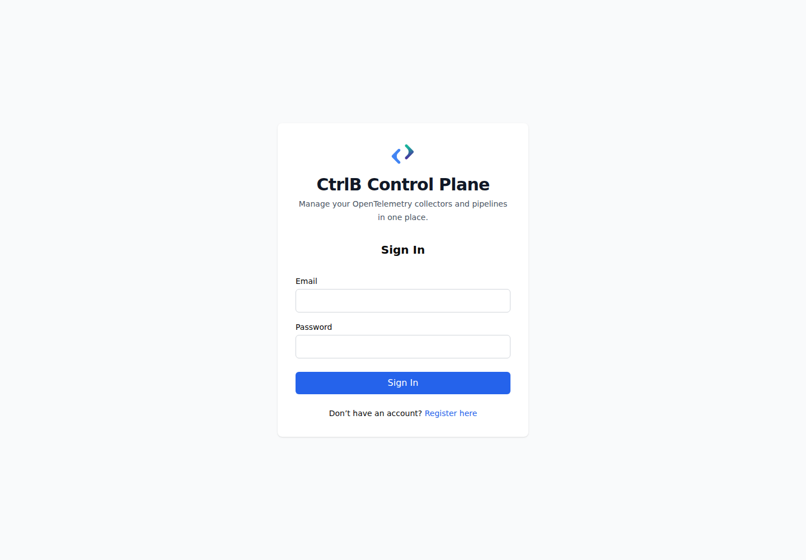

*Sign in to reach the pipeline list.*

Use **Logout** on the pipeline list to end your browser session.

## Find a pipeline

The **Pipelines** page lists VM pipelines and Kubernetes installations together. Select a pipeline name or its row to open details.

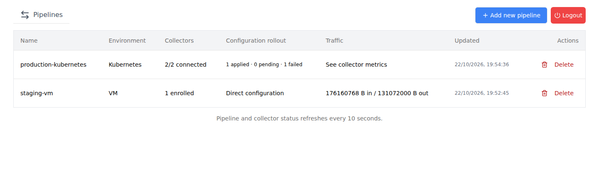

*The list shows enrollment and configuration rollout for each environment.*

| Column | What to read |
| --- | --- |
| Environment | `VM` or `Kubernetes`. |
| Collectors | VM enrollment count, Kubernetes connected/enrolled count, or **Waiting for enrollment**. |
| Configuration rollout | Kubernetes counts for `applied`, `pending`, and `failed`, with disconnected collectors shown separately. VM rows show **Direct configuration**. |
| Traffic | VM incoming/outgoing byte counts. Open Kubernetes details for collector metrics. |
| Updated | The pipeline's last recorded update time. |
| Actions | **Delete** opens a confirmation dialog. |

The list refreshes every ten seconds. If a refresh fails, the page keeps its last result and warns that shown data may be stale.

## Choose where collectors run

Select **Add new pipeline**, then choose an environment.

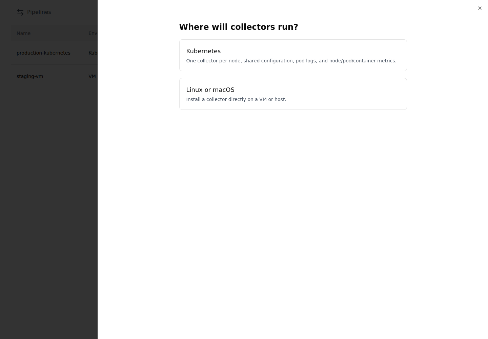

*Choose Kubernetes for a collector on each eligible node, or the host workflow for a VM.*

- **Kubernetes** creates a shared pipeline and an installation, then generates a DaemonSet manifest. Collectors initiate outbound management connections.
- **Linux or macOS** opens the host installation form. VM management requires the backend to reach the collector's management and metrics ports.

Use **Back to environments** to change your choice before creating an installation.

## Install Kubernetes collectors

You need kubectl access to a Linux cluster, a collector image the cluster can pull, and a telemetry destination. Review the [Kubernetes setup prerequisites](kubernetes-setup.md#prerequisites) before proceeding.

### Enter installation settings

Select **Kubernetes** and complete the form.

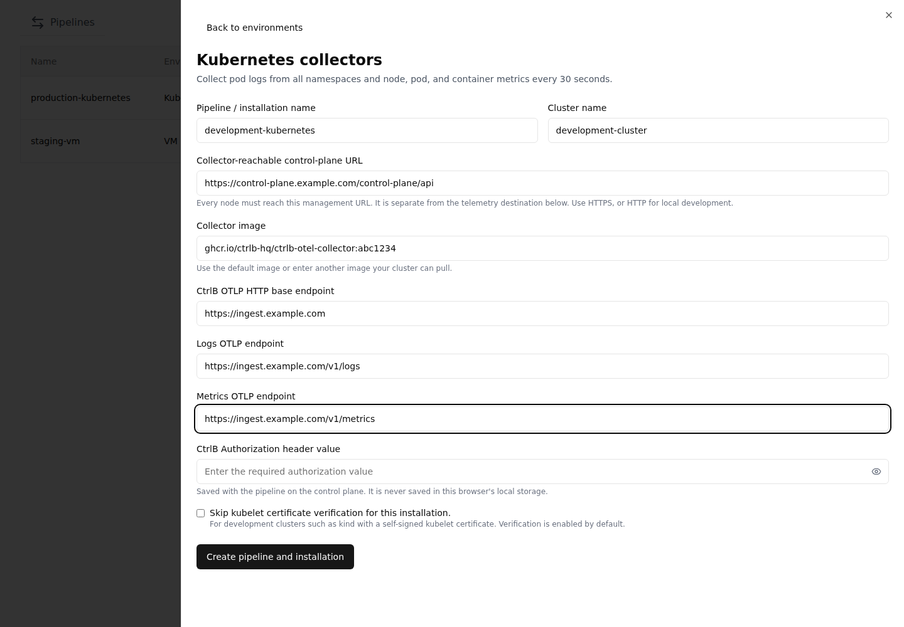

*The management URL connects collectors to this control plane. OTLP endpoints send telemetry to your destination.*

| Field | Value to provide |
| --- | --- |
| Pipeline / installation name | A name you can recognize in the pipeline list. |
| Cluster name | The cluster label included in collected telemetry. It does not select a kubectl context. |
| Collector-reachable control-plane URL | The API root, including `/api`, reachable from every node. For example, `https://control-plane.example.com/control-plane/api`. A browser's `localhost` usually will not work from a cluster. |
| Collector image | A published image tag or digest supported by your cluster. The form suggests `ghcr.io/ctrlb-hq/ctrlb-otel-collector:latest`; publication workflows use short commit tags, so replace it with an available tag or digest. |
| CtrlB OTLP HTTP base endpoint | The base URL for your telemetry destination. |
| Logs OTLP endpoint | An explicit logs URL if your destination needs one. Leave empty to use the exporter's base-endpoint behavior. |
| Metrics OTLP endpoint | An explicit metrics URL if your destination needs one. Leave empty to use the exporter's base-endpoint behavior. |
| CtrlB Authorization header value | The complete value required by your destination, if any. It is saved with the pipeline. |
| Skip kubelet certificate verification for this installation. | Enable only when your kubelet certificate setup requires it, such as a development cluster with self-signed certificates. Verification is enabled by default. |

Use your own destination URLs and authorization value. The form's prefilled URLs and the screenshot values are examples, not credentials for your deployment. Changing only the base endpoint leaves the prefilled logs and metrics URLs in effect. Replace those URLs too, or clear them to derive signal URLs from the base endpoint. For endpoint behavior and cluster requirements, see the [Kubernetes setup guide](kubernetes-setup.md).

Select **Create pipeline and installation**. This saves a preset for pod logs and node, pod, and container metrics. Metrics collection runs every thirty seconds.

If the pipeline saves but installation creation fails, select **Retry installation creation**. The form retains the saved pipeline for that retry.

### Save and apply the manifest

The next screen is **Install collectors in _your cluster_**.

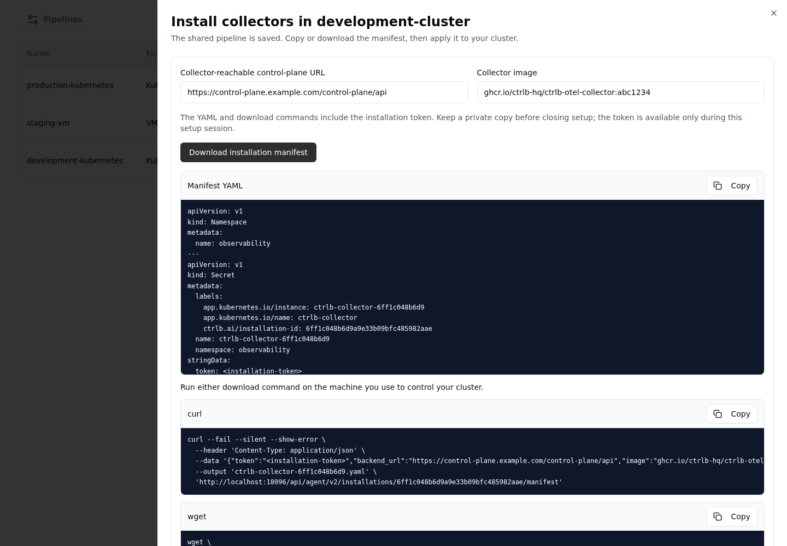

*Save the manifest before closing setup. The browser does not apply it to the cluster.*

1. Select **Download installation manifest**, or use **Copy** on **Manifest YAML**, **curl**, or **wget**.
2. Keep the downloaded YAML or download command private. It contains the installation token, which is only available during this setup session.
3. On a machine with kubectl access, select the intended context and run the generated **Apply and check rollout** commands.
4. Wait for the DaemonSet rollout, then check the installation's node table. Nodes appear after their first check-in.

The generated filename is `ctrlb-collector-<first-12-installation-id-characters>.yaml`. The manifest creates resources in `observability` and installation-specific cluster permissions. The [full setup guide](kubernetes-setup.md#apply-the-manifest) includes commands with an explicit Kubernetes context.

You can correct **Collector-reachable control-plane URL** or **Collector image** on this screen. Either change regenerates the manifest, so download or copy the updated version. Use **Retry manifest generation** if generation fails.

**View/edit pipeline configuration** becomes available after a download or a successful **Copy** action on the manifest or a download command. Selecting and copying text manually does not enable it.

Closing setup preserves the saved pipeline and installation. It discards unsaved edits and the setup session's copy of the installation token. Keep the manifest before choosing **Close setup**.

## Connect a VM collector

The host form asks for **Name** and **Platform**, with **Linux** and **macOS** choices. Select **Generate Config** to display **Run Command**.

The generated command currently uses a Linux systemd installer for both platform choices. Its expected binary filenames also differ from the release workflows. Use the source workflow below, or verify compatible release assets before using the generated installer. The macOS selection does not provide a working macOS installer.

### Run the collector from source

First install the [getting-started prerequisites](getting-started.md#prerequisites), start the backend and frontend, and sign in. From the repository root, run:

```bash
cd agent
cp internal/config/config.yaml /tmp/ctrlb-vm-config.yaml
export BACKEND_URL=http://localhost:8096
export PIPELINE_NAME=local-vm
export STARTED_BY=dev@example.com
export AGENT_CONFIG_PATH=/tmp/ctrlb-vm-config.yaml
go run ./cmd/ctrlb_collector
```

Replace the backend URL, pipeline name, and email for your setup. VM `BACKEND_URL` is the backend root without `/api`. Leave `INSTALLATION_ID` unset. The configuration file must exist and remain writable.

Registration with `PIPELINE_NAME` creates a new default pipeline. Reusing a name does not join an existing pipeline. The backend must reach the registered collector on ports `3421` and `8888` for management and metrics. See [connect a VM collector](getting-started.md#connect-a-vm-collector) for network details.

Open **Pipelines** after registration and select the new VM pipeline.

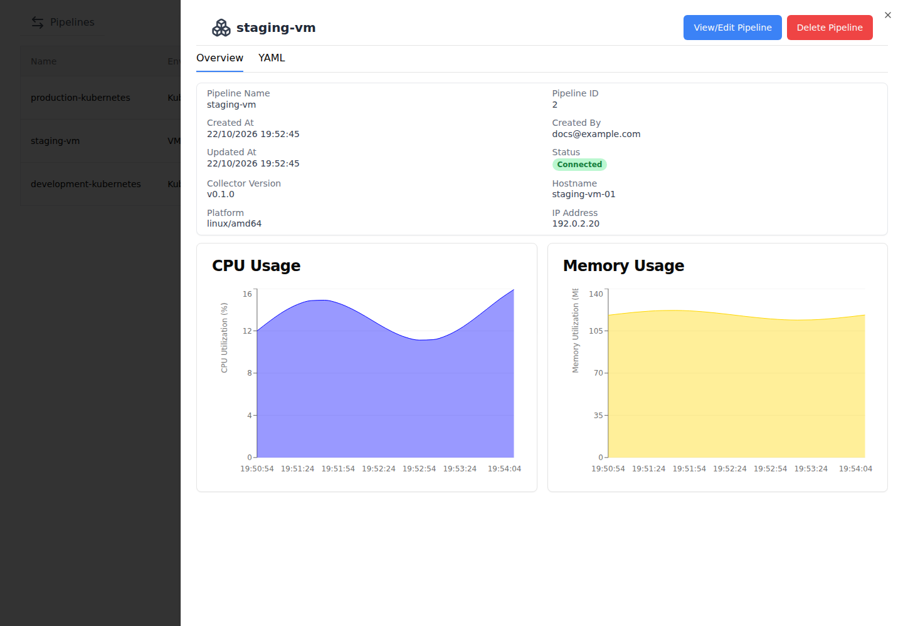

*VM details show collector identity, connection status, and available CPU and memory history.*

If you use the UI installation flow with compatible assets, use its copy icon before starting the collector. Copy starts heartbeat detection. Wait for **Your agent is successfully deployed**, then select **Configure Pipeline**. **Try again** restarts detection after **Heartbeat not detected**. The configure button can appear before enrollment succeeds, so wait for confirmation.

VM details have **Overview** and **YAML** tabs. **YAML** is a read-only configuration preview. **View/Edit Pipeline** opens the graph editor.

## Edit a pipeline

Open a pipeline from the list. Select **View/edit configuration** for Kubernetes or **View/Edit Pipeline** for a VM. During Kubernetes setup, use **View/edit pipeline configuration**.

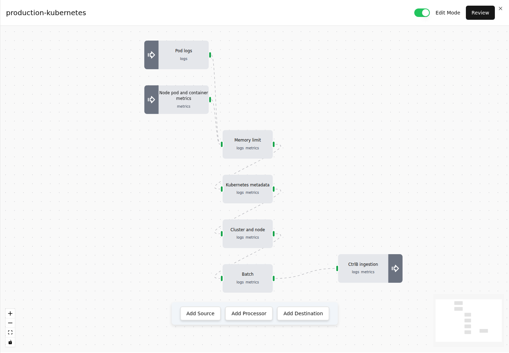

*Edges define the processing order between sources and destinations.*

Enable **Edit Mode** before changing the graph or saving configuration.

### Change a component setting

For example, change an existing batch timeout to `5s`:

1. Select the **Batch** node to open its configuration form.
2. Set **Timeout** to `5s`. Keep the other fields appropriate for your pipeline.
3. Select **Apply** to keep the change in the editor draft.
4. Select **Review** and inspect **Pending Changes**.
5. Select **Save configuration** for Kubernetes, or **Deploy Changes** for a VM.

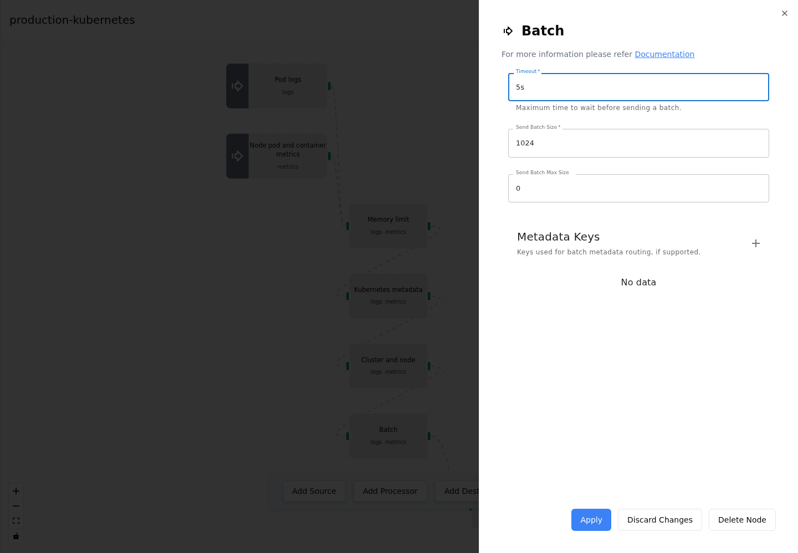

*Apply updates the draft. Review and save to send the configuration to the control plane.*

The Kubernetes preset already uses `5s`. If that value is unchanged, the compiled configuration keeps its existing revision. Use this walkthrough when changing a different current value, or choose another intended setting.

### Add a field to logs

Add `log_source=ctrlb_otel_collector` to new log records, save the configuration, then check a record in CtrlB Logs.

1. Open the Kubernetes preset pipeline and enable **Edit Mode**.
2. Select **Add Processor**, then **Attributes Processor Configuration**.
3. Expand the first entry under **Actions** and enter these settings:

| Field | Value |
| --- | --- |
| Attribute Key | `log_source` |
| Value type | **Text** |
| Value | `ctrlb_otel_collector` |
| Action | `insert` |

Leave **From Attribute** empty and leave **Include Filter** and **Exclude Filter** unset. Select **Add Processor** to add the configured node to the draft.

To add more fields in the same processor, use **+** beside **Actions** and configure another key, value, and action for each field. The processor affects telemetry routed through it.

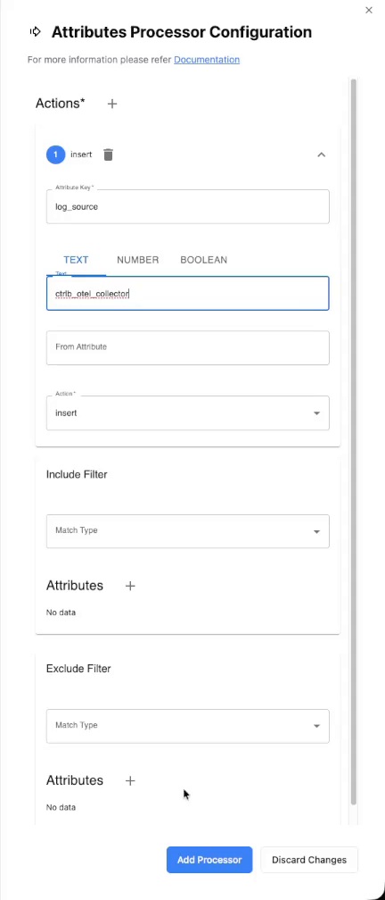

*The insert action adds the field when it is missing. It preserves an existing value for the same key.*

4. Select the existing edge from **Batch** to **CtrlB ingestion**, then select its trash icon to remove that connection.
5. Connect **Batch** to the new **Attributes Processor Configuration** node, then connect that node to **CtrlB ingestion**. Keep the existing source connections and earlier processors in place.

The end of the path should now be `Batch → Attributes Processor Configuration → CtrlB ingestion`. Remove the original direct edge so logs pass through the new processor before export.

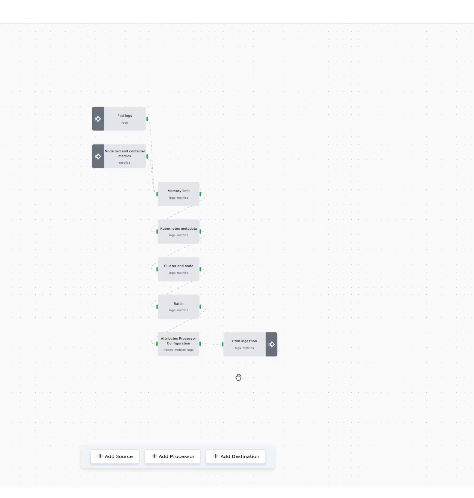

*The new processor sits in the existing path before the destination.*

6. Select **Review**. Check that **Pending Changes** includes the new processor, the removed direct edge, and the two replacement edges, then select **Save configuration**.
7. Return to the installation's collector table and wait for each node's configuration to show **applied**. Use **Refresh** to check progress.
8. Generate a fresh workload log, open **Logs** in CtrlB, and select the dataset configured as your destination, such as `control_plane`.
9. Run a query covering the time after rollout, open a new log record, and confirm that its fields include `log_source` with the value `ctrlb_otel_collector`.

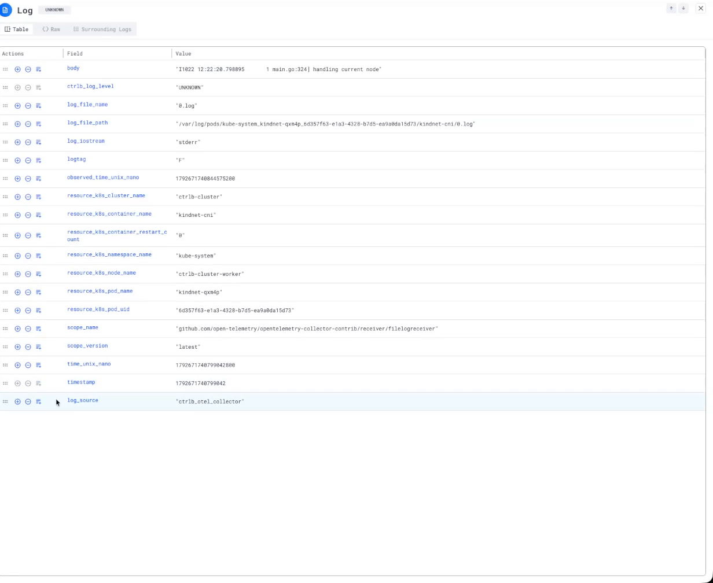

*The destination confirms that a new log passed through the updated pipeline.*

Previously ingested records keep their original fields. If the new field is missing, confirm that every collector applied the revision and inspect a log generated after rollout.

### Add or reconnect components

- Select **Add Source**, **Add Processor**, or **Add Destination**, choose a component, fill in its form, and select the matching **Add ...** button.
- Drag a component's right connection handle to the next component's left handle. Connect each source through its processors to a destination that supports its signals.
- To remove a connection, select its edge and then the trash icon. To remove a component, open its form and select **Delete Node**.
- Use **Discard Changes** in a component form to abandon that form's draft.

Every source needs an ordered path to a destination. Review signal labels on components and preserve the intended processor order when reconnecting a pipeline.

### Review and save

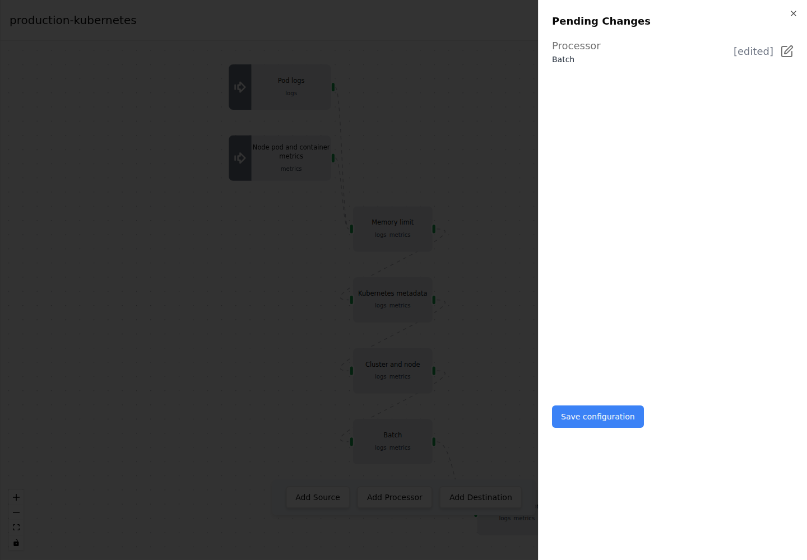

*Pending Changes lists edits before the final save action.*

For Kubernetes, **Configuration saved** means the control plane stored the desired configuration. A changed compiled configuration creates a revision that every collector in the installation applies at its next check-in. Check rollout status after saving.

Each collector validates the update and restarts its embedded Collector to apply it, which can briefly interrupt collection. If startup fails, it attempts to restore its previous working configuration. Other nodes continue independently. Correct a failed configuration and save a changed revision; an unchanged rejected revision is not repeatedly retried.

For a VM, **Deploy Changes** saves the graph and uses the VM management path to update its collector. Check the collector status and destination after deployment.

Closing an editor with unsaved changes opens a discard confirmation. Keep editing to preserve your draft, or confirm discard to retain only the last saved configuration.

## Check collector status

Open a Kubernetes pipeline to see each installation and its enrolled nodes. Use **Refresh** for an immediate check. The view also refreshes every ten seconds.

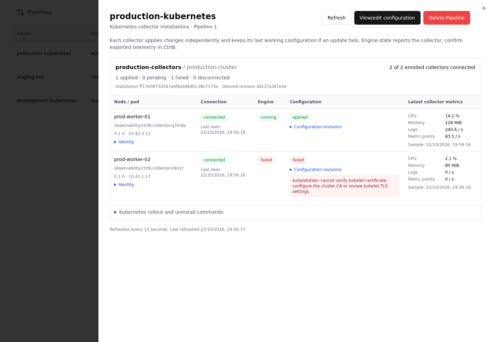

*Connection, engine, and configuration status describe separate conditions. These example rows are synthetic.*

| Column or state | Meaning |
| --- | --- |
| Connection: `connected` | The control plane received a recent check-in. After more than thirty-five seconds without one, it reports `disconnected`. |
| Engine: `waiting`, `running`, or `failed` | The last reported state of the embedded Collector process. |
| Configuration: `pending` | The collector has not reported the desired revision running successfully. |
| Configuration: `applied` | The collector reports the desired revision and a running engine. |
| Configuration: `failed` | The collector attempted the desired revision and reported an error or failed engine. It may still run its previous working revision. |
| Latest collector metrics | Collector CPU, memory, exported logs per second, and metric points per second. Missing samples show **Unavailable**. |

Expand **Configuration revisions** to compare **Desired**, **Applied**, and **Attempted**. Read the current configuration error when rollout fails. **Previous configuration error** can retain an older failure after the desired configuration is working.

A disconnected collector may continue collecting with cached configuration. Connection loss does not establish that its process stopped. If the control plane cannot refresh, the view keeps the last known status and reports the error.

Verify telemetry at the destination separately. Generate a new identifiable workload log after enrollment and allow at least one thirty-second interval for metrics. The preset begins reading new log files at their end, so old entries are not backfilled. See [verify enrollment and telemetry](kubernetes-setup.md#verify-enrollment-and-telemetry).

## Delete a pipeline

Select **Delete** in the list or **Delete Pipeline** in pipeline details.

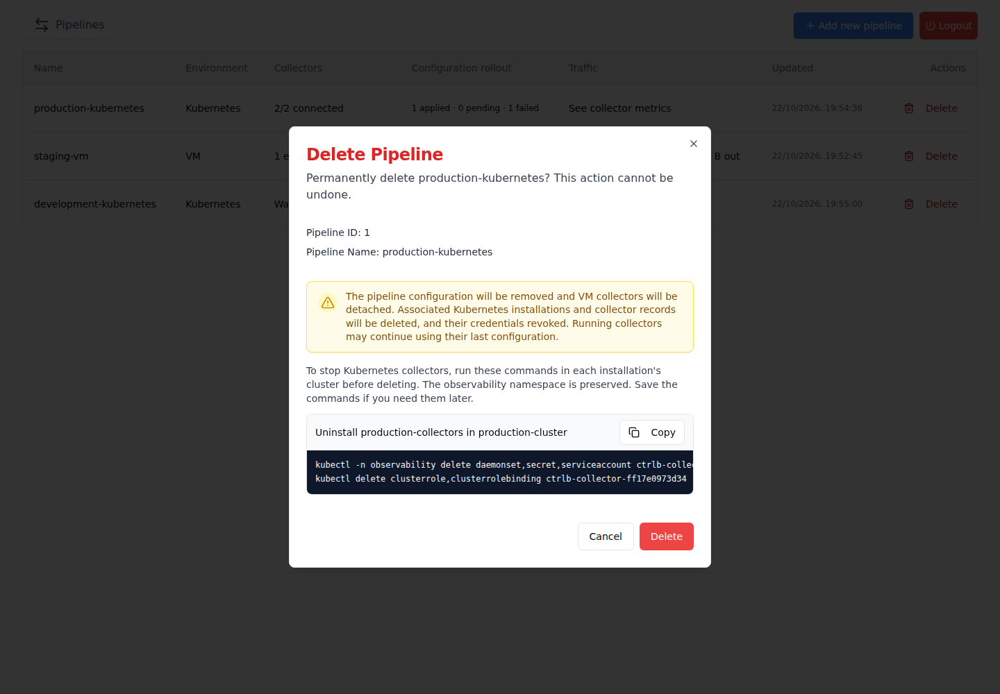

*Review the pipeline and stop its Kubernetes resources before deleting control-plane records.*

1. For Kubernetes, expand **Kubernetes rollout and uninstall commands** in pipeline details, or use the commands in the delete dialog.
2. Run those commands in each installation's intended cluster before confirming deletion. They remove that installation's resources and preserve the shared `observability` namespace.
3. Select **Delete** in the confirmation dialog, or **Cancel** to keep the pipeline.

Deletion removes the pipeline configuration, detaches VM collectors, deletes associated Kubernetes inventory, and revokes installation credentials. It does not uninstall cluster resources or stop collector processes. Collectors left running may continue exporting with their last configuration.

Avoid `kubectl delete -f` on the generated manifest because it includes the shared namespace. Use the installation-specific uninstall commands instead. Uninstall does not erase the node's saved configuration or log offsets. See [uninstall this installation](kubernetes-setup.md#uninstall-this-installation).

## Resolve common problems

| Problem | Next step |
| --- | --- |
| Kubernetes shows **Waiting for collectors to enroll** | Apply the manifest in the intended context, check the DaemonSet rollout, then confirm pods can reach the management API URL. |
| Pod shows `ImagePullBackOff` | Check the published image tag, registry access, and node architecture. |
| Collector is `running` but configuration is `failed` | Compare revision details and read the error. Fix the configuration and save a changed revision. |
| Status refresh fails | Check backend availability and network access. Treat the retained values as the last known result. |
| VM is disconnected or has no health metrics | Check the registered hostname/IP and backend access to ports `3421` and `8888`. Use the status refresh icon when shown for a disconnected, pending, or inactive collector. |
| No telemetry arrives | Check the destination URLs, authorization, collector errors, and destination ingestion. Generate fresh logs and allow a metrics interval. |

Use [troubleshooting](troubleshooting.md) for collector diagnostics, and [Kubernetes setup](kubernetes-setup.md#diagnose-an-installation) for kubectl inspection commands.
